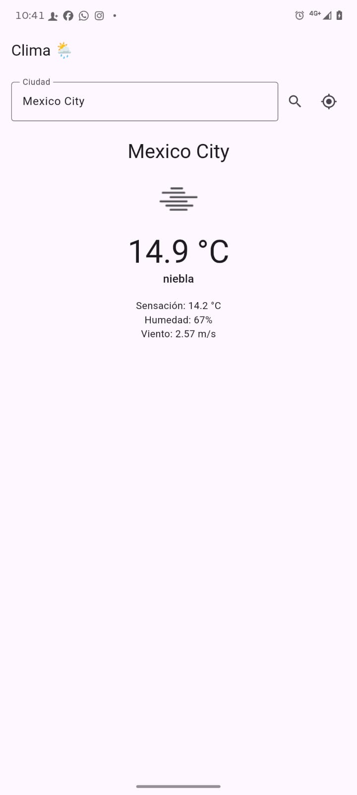
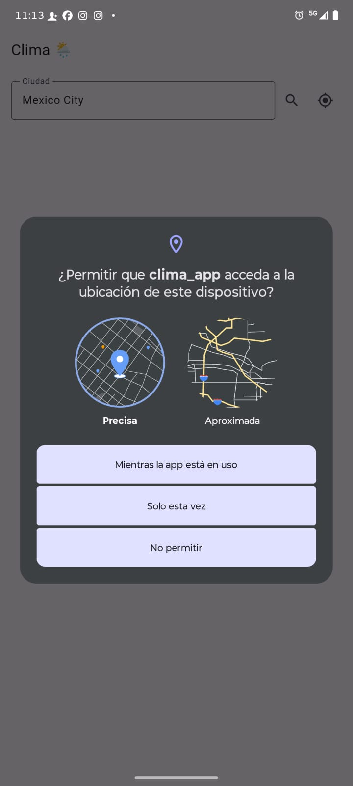
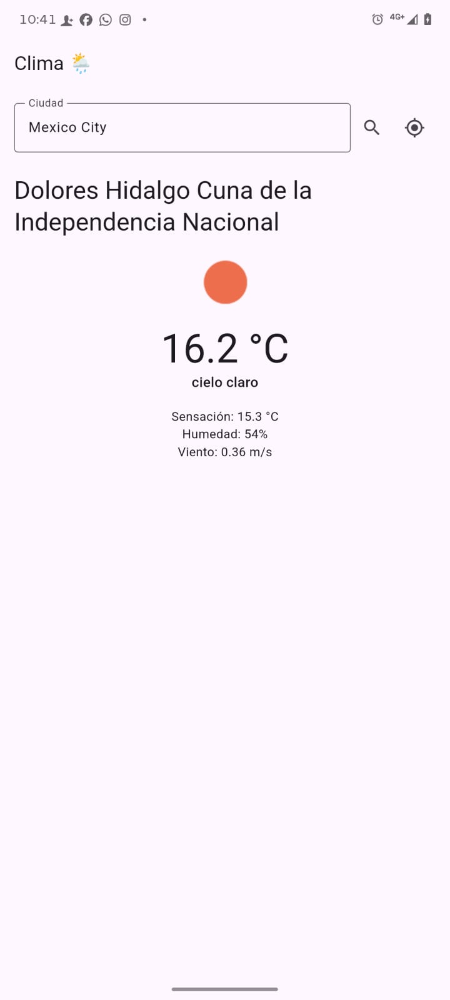

# Clima App 🌦

App en Flutter que muestra el clima actual con la API de OpenWeatherMap.

## Funciones
- Buscar clima por ciudad
- Ubicación automática con geolocator
- Estados de carga y de error

## Cómo correrla
1. `flutter pub get`
2. Pon tu API key en `lib/config/constants.dart`
   (o usa `--dart-define=OWM_API_KEY=tu_key`)
3. `flutter run`

## Estructura
models/ · services/ · screens/ · widgets/ · config/

## Evidencia del funcionamiento

